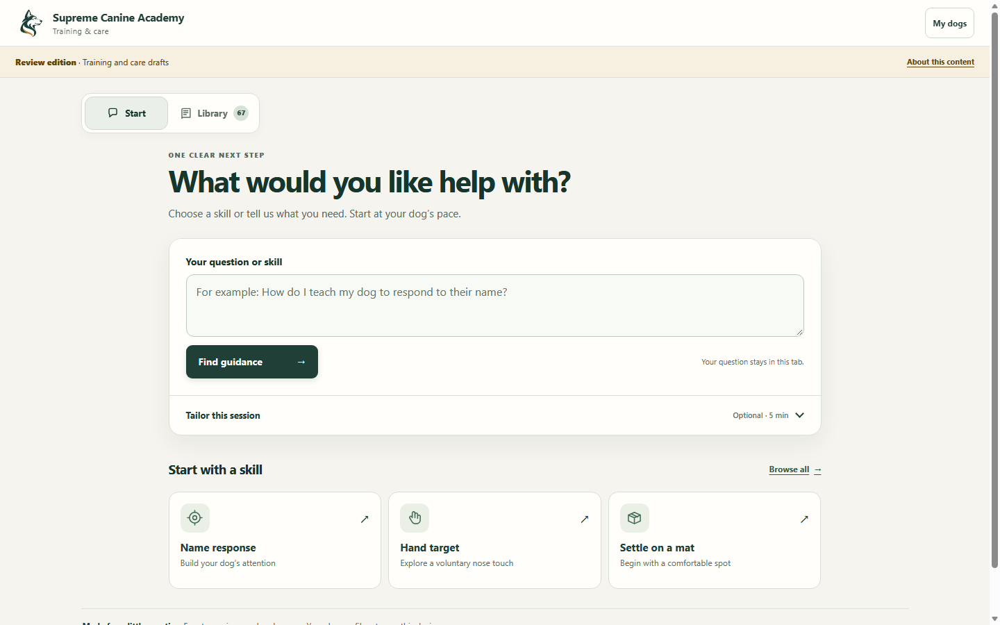

# Supreme Canine Academy

A free, approachable dog-training and care review library. Ask a question, choose a skill, and read the source behind the guidance.

**[Use the public app](https://supreme-canine-academy.web.app/)** · **[Report a problem](https://github.com/leavesofhabit-tech/supreme-canine-academy/issues)** · **[Contribute](CONTRIBUTING.md)**




## What it does

- Searches 67 training, care, and safety review resources using local, source-grounded matching.
- Supports common spelling variants, everyday phrasing, explicit source codes, and follow-up questions.
- Shows the selected source's guidance and citations, including actual care-guide passages.
- Keeps dog profiles on the current device and works without sign-in.
- Supports phones, tablets, desktops, keyboard navigation, and offline reading after the app is cached.
- Uses static Schema.org metadata for its brand, website, page, and web application.

This is a review library with deterministic retrieval, not a general-purpose AI assistant. Source draft/review labels remain visible. The material is general education, not a diagnosis, individual treatment plan, or clinically validated resource. Unfamiliar wording can still require rephrasing.

## Free access

The app is currently free. The owner intends to keep it free **unless operating costs make a change necessary**. No paid AI, subscriptions, or payment processing are enabled. See [FREE-ACCESS.md](FREE-ACCESS.md) for the policy and the distinction between the hosted service and the software license.

## Run it locally

Use **Node.js 24 LTS** (Node 22.4 or later is required), npm, and Git. This repository is self-contained; it needs no private corpus, Firebase account, or API key.

```sh
git clone https://github.com/leavesofhabit-tech/supreme-canine-academy.git
cd supreme-canine-academy
npm ci
npm test
npm run dev
```

Open **http://127.0.0.1:4173/**. On PowerShell, use `npm.cmd` if your execution policy blocks `npm.ps1`.

```sh
npm run build          # Generate dist/
npm run preview        # Serve dist/ locally
npm run smoke:browser  # Isolated Chrome/Edge smoke; manages its own local server
```

The browser smoke needs an installed Chrome or Edge. Set `BROWSER_PATH` if it is not found automatically. Tests and builds work without a browser or cloud connection after dependencies are installed.

## How the project is organized

| Path | Purpose |
| --- | --- |
| `src/` | Interface, local matching, profile storage, privacy, and optional-client boundaries |
| `data/knowledge.json` | The same sanitized reader corpus used by the public app |
| `public/` | Manifest, approved logo, and offline service worker |
| `tests/` | Retrieval, input, safety, privacy, metadata, persistence, and cache regressions |
| `backend/` | Disabled prototype and pure mocked tests; not a turnkey production deployment |
| `site.config.json` | Public canonical identity used by metadata checks |
| `scripts/` | Portable validation, build, packaging, and browser smoke |

`npm test` and `npm run build` validate the committed reader payload. They do not regenerate it from private source material. The current 67-record / zero-production-eligible boundary is deliberate. Changes to corpus size require coordinated updates to startup, build, and regression contracts.

## Help improve it

Bug reports, accessibility fixes, better supported-input coverage, source corrections, and focused pull requests are welcome. Include the exact query or record ID and the expected behavior. Please use synthetic profiles and keep private pet, client, account, and medical information out of issues.

Read [CONTRIBUTING.md](CONTRIBUTING.md) before changing retrieval or content. Preserve the owner-confirmed cue meanings, conservative safety referrals, source attribution, account separation, and local-data boundaries. CI runs tests, build, and a browser smoke on pull requests. See [SECURITY.md](SECURITY.md) for private security reporting.

## Hosting and forks

The official public app is hosted on Google Firebase Hosting. This repository includes no production credentials, private deployment records, DNS snapshots, or automatic production-deployment workflow. Forks can serve the generated `dist/` at the **origin root** of a static host; choose and review your own provider and costs. GitHub project Pages at `/repository-name/` needs base-path changes and is not enabled by this setup.

Before publishing a renamed fork, update the visible brand, `site.config.json`, canonical/JSON-LD URLs in `index.html`, and manifest identity. Keep those values consistent and run the metadata tests. Hosted Firebase Auth/Functions are disabled in `config.js`; enabling them requires your own project, access policy, App Check, integration testing, and cost review.

## License

Original application code and tooling: **[MIT](LICENSE)**. Original editorial corpus text, third-party materials, and branding have separate scopes in [CONTENT-LICENSE.md](CONTENT-LICENSE.md). Dependency notices are retained in [THIRD-PARTY-NOTICES.md](THIRD-PARTY-NOTICES.md).
